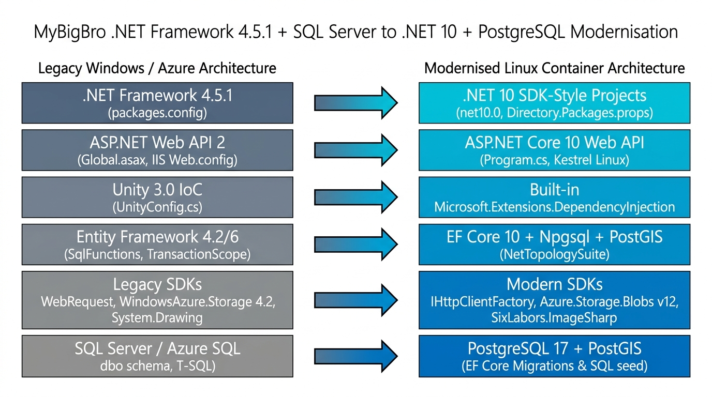
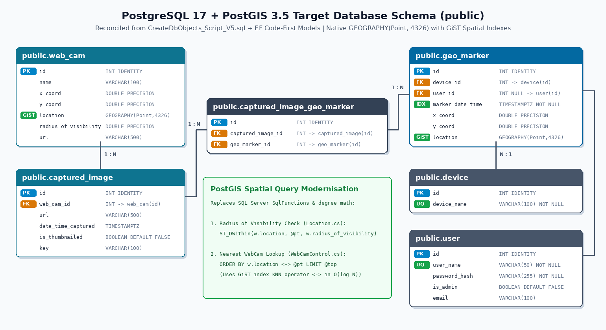
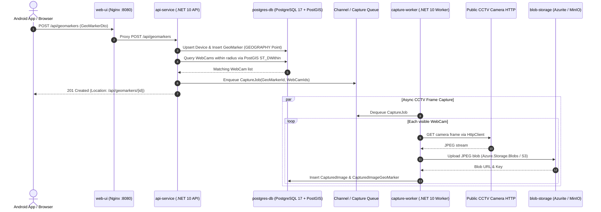

# MyBigBro-Azure Modernisation Plan: .NET 10, PostgreSQL/PostGIS & Linux Docker Containers

## 1. Executive Summary

This document defines the end-to-end engineering plan to modernise the legacy **MyBigBro-Azure** solution ([`Infostructure.MyBigBro.Web.sln`](file:///home/bernard/Source/MyBigBro-Azure/Infostructure.MyBigBro.Web.sln)) from a Windows-only **.NET Framework 4.5.1 / ASP.NET Web API 2 / Entity Framework 4.2–6.0 / SQL Server** monolith into a cloud-native, cross-platform **.NET 10 / PostgreSQL 17 (PostGIS) / Linux Docker Compose** multi-container system.

### Key Modernisation Objectives
1. **Runtime & SDK Upgrade (.NET 10 on Linux)**: Migrate all projects from legacy non-SDK `.csproj` (`.NET Framework 4.5.1`) and DNX `wrap/project.json` files to modern SDK-style `net10.0` projects with Central Package Management (`Directory.Packages.props`).
2. **Web & Dependency Injection Modernisation**: Replace IIS/`System.Web`/`Global.asax`, ASP.NET Web API 2 (`System.Web.Http`), `FormsAuthentication`, and Unity 3.0 IoC ([`UnityConfig.cs`](file:///home/bernard/Source/MyBigBro-Azure/Infostructure.MyBigBro.Web4/App_Start/UnityConfig.cs)) with **ASP.NET Core 10**, Kestrel, `Program.cs` minimal hosting, and built-in `Microsoft.Extensions.DependencyInjection`.
3. **Database Modernisation (PostgreSQL 17 + PostGIS)**: Migrate from SQL Server / Azure SQL and Entity Framework 4.2/6.0 ([`MyBigBroContext.cs`](file:///home/bernard/Source/MyBigBro-Azure/Infostructure.MyBigBro.DataModel/DataAccess/MyBigBroContext.cs)) to **PostgreSQL 17 + PostGIS 3.5** using **EF Core 10** (`Npgsql.EntityFrameworkCore.PostgreSQL` and `Npgsql.EntityFrameworkCore.PostgreSQL.NetTopologySuite`). Reconcile the schema drift between [`CreateDbObjects_Script_V5.sql`](file:///home/bernard/Source/MyBigBro-Azure/Infostructure.MyBigBro.Database/CreateDbObjects_Script_V5.sql) and the C# domain models, and replace `SqlFunctions.SquareRoot` / `TransactionScope` with PostGIS spatial functions (`ST_DWithin`, KNN `<->`) and EF Core database transactions.
4. **Linux-Compatible I/O & Cloud Storage**: Replace obsolete `WebRequest` ([`WebCamDataRequest.cs`](file:///home/bernard/Source/MyBigBro-Azure/Infostructure.MyBigBro.BusinessLogic/WebCam/WebCamDataRequest.cs)), Windows-only `System.Drawing.Image` ([`TestPutImage.cs`](file:///home/bernard/Source/MyBigBro-Azure/IntegrationTests/Infostructure/MyBigBro/ImageStorageAgent/TestPutImage.cs)), and legacy `WindowsAzure.Storage` / `AWSSDK` v1 ([`AzureStorageServiceAgent.cs`](file:///home/bernard/Source/MyBigBro-Azure/Infostructure.MyBigBro.ImageStorageServiceAgent/AzureStorageServiceAgent.cs), [`AwsStorageServiceAgent.cs`](file:///home/bernard/Source/MyBigBro-Azure/Infostructure.MyBigBro.ImageStorageServiceAgent/AwsStorageServiceAgent.cs)) with `IHttpClientFactory`, `SixLabors.ImageSharp`, `Azure.Storage.Blobs` v12, and `AWSSDK.S3` v4.
5. **Containerised Microservices via Docker Compose**: Package the system into Linux containers orchestrated with a single `docker compose up --build` command, separating the **Web UI / Reverse Proxy (`web-ui`)**, **REST API (`api-service`)**, **Asynchronous CCTV Capture Worker (`capture-worker`)**, **PostgreSQL/PostGIS (`postgres-db`)**, and **Local Blob Storage Emulator (`blob-storage` via Azurite or MinIO)**.

---

## 2. Architecture Overview & Diagrams

### 2.1 Target Linux Container & Microservices Architecture


### 2.2 Legacy-to-Modern Stack Transformation



### 2.3 Target PostgreSQL 17 + PostGIS Database Schema



### 2.4 Request & Asynchronous Capture Sequence (Mermaid)



---

## 3. Audit of Current Codebase & Blockers for Linux / .NET 10 / PostgreSQL

A thorough audit of [`~/Source/MyBigBro-Azure`](file:///home/bernard/Source/MyBigBro-Azure) identified the following components and technical blockers:

| Project / Directory | Current Role | Legacy Dependencies & Linux/.NET 10 Blockers |
| :--- | :--- | :--- |
| [`Infostructure.MyBigBro.Domain`](file:///home/bernard/Source/MyBigBro-Azure/Infostructure.MyBigBro.Domain/Infostructure.MyBigBro.Domain.csproj) | Domain interfaces & DTOs (`IGeoMarker`, `IWebCam`, `CapturedImageDto`, `GeoMarkerDto`, `User`) | Targets `.NET Framework 4.5.1`; uses old `System.ComponentModel.DataAnnotations` assembly reference. Clean C# code, easiest to port first. |
| [`Infostructure.MyBigBro.DataModel`](file:///home/bernard/Source/MyBigBro-Azure/Infostructure.MyBigBro.DataModel/Infostructure.MyBigBro.DataModel.csproj) | EF `DbContext` ([`MyBigBroContext.cs`](file:///home/bernard/Source/MyBigBro-Azure/Infostructure.MyBigBro.DataModel/DataAccess/MyBigBroContext.cs)), repository ([`MyBigBroRepository.cs`](file:///home/bernard/Source/MyBigBro-Azure/Infostructure.MyBigBro.DataModel/DataAccess/MyBigBroRepository.cs)), and entity models | References `EntityFramework 4.2.0.0` (`System.Data.Entity`, `System.Data.EntityState`). Hardcodes `[Table("...", Schema = "dbo")]` on all entities ([`WebCam.cs`](file:///home/bernard/Source/MyBigBro-Azure/Infostructure.MyBigBro.DataModel/Models/WebCam.cs), [`GeoMarker.cs`](file:///home/bernard/Source/MyBigBro-Azure/Infostructure.MyBigBro.DataModel/Models/GeoMarker.cs), [`CapturedImage.cs`](file:///home/bernard/Source/MyBigBro-Azure/Infostructure.MyBigBro.DataModel/Models/CapturedImage.cs), [`CapturedImageGeoMarker.cs`](file:///home/bernard/Source/MyBigBro-Azure/Infostructure.MyBigBro.DataModel/Models/CapturedImageGeoMarker.cs), [`Device.cs`](file:///home/bernard/Source/MyBigBro-Azure/Infostructure.MyBigBro.DataModel/Models/Device.cs), [`User.cs`](file:///home/bernard/Source/MyBigBro-Azure/Infostructure.MyBigBro.DataModel/Models/User.cs)). |
| [`Infostructure.MyBigBro.Database`](file:///home/bernard/Source/MyBigBro-Azure/Infostructure.MyBigBro.Database/Infostructure.MyBigBro.Database.sqlproj) | Visual Studio SQL Server Database Project (`CreateDbObjects_Script_V1..V5.sql`, `PopulateWebCamTable_Script_V1.sql`) | Uses T-SQL syntax (`USE [MyBigBro]`, `GO`, `IDENTITY(1,1)`, `bit`, `datetime`, `CLUSTERED`, `geometry::STPointFromText`). **Schema drift**: [`CreateDbObjects_Script_V5.sql`](file:///home/bernard/Source/MyBigBro-Azure/Infostructure.MyBigBro.Database/CreateDbObjects_Script_V5.sql) defines `dbo.User` and `GeoMarker.UserId`, whereas C# [`MyBigBroContext.cs`](file:///home/bernard/Source/MyBigBro-Azure/Infostructure.MyBigBro.DataModel/DataAccess/MyBigBroContext.cs) queries `dbo.Device` and `GeoMarker.DeviceId`. |
| [`Infostructure.MyBigBro.ImageStorageServiceAgent`](file:///home/bernard/Source/MyBigBro-Azure/Infostructure.MyBigBro.ImageStorageServiceAgent/Infostructure.MyBigBro.ImageStorageServiceAgent.csproj) | Blob storage abstraction (`IStorageServiceAgent`) with AWS S3 & Azure Blob implementations | Uses `System.Configuration.ConfigurationManager.AppSettings`, legacy `WindowsAzure.Storage 4.2.0.0`, and a local binary `Resources/AWSSDKAndSamples_1.5.5.1/AWSSDK.dll` (`Amazon.AWSClientFactory`). |
| [`Infostructure.MyBigBro.BusinessLogic`](file:///home/bernard/Source/MyBigBro-Azure/Infostructure.MyBigBro.BusinessLogic/Infostructure.MyBigBro.BusinessLogic.csproj) | Core services (`GeoMarkerService`, `AccountService`, `FormsAuthenticationService`), spatial math (`Geometry`, `Location`), webcam capture (`WebCamControl`) | 1. [`WebCamControl.cs`](file:///home/bernard/Source/MyBigBro-Azure/Infostructure.MyBigBro.BusinessLogic/WebCam/WebCamControl.cs#L125) and [`Geometry.cs`](file:///home/bernard/Source/MyBigBro-Azure/Infostructure.MyBigBro.BusinessLogic/GeoSpatial/Geometry.cs#L2) import `System.Data.Objects.SqlClient.SqlFunctions` (`SqlFunctions.SquareRoot`, `SqlFunctions.Square`) which only works on SQL Server EF.<br>2. [`FormsAuthenticationService.cs`](file:///home/bernard/Source/MyBigBro-Azure/Infostructure.MyBigBro.BusinessLogic/Services/FormsAuthenticationService.cs#L2) uses `System.Web.Security.FormsAuthentication` (not available in .NET Core / .NET 10).<br>3. [`GeoMarkerService.cs`](file:///home/bernard/Source/MyBigBro-Azure/Infostructure.MyBigBro.BusinessLogic/Services/GeoMarkerService.cs#L114) and [`WebCamControl.cs`](file:///home/bernard/Source/MyBigBro-Azure/Infostructure.MyBigBro.BusinessLogic/WebCam/WebCamControl.cs#L94) wrap HTTP + Blob + DB operations inside `System.Transactions.TransactionScope` (causes distributed transaction promotion failures on Linux/PostgreSQL).<br>4. [`WebCamDataRequest.cs`](file:///home/bernard/Source/MyBigBro-Azure/Infostructure.MyBigBro.BusinessLogic/WebCam/WebCamDataRequest.cs#L11) uses obsolete `System.Net.WebRequest.Create`. |
| [`Infostructure.MyBigBro.Web4`](file:///home/bernard/Source/MyBigBro-Azure/Infostructure.MyBigBro.Web4/Infostructure.MyBigBro.Web4.csproj) | ASP.NET Web API 2 host + AngularJS 1.3 frontend (`index.html`, `app/`, `scripts/`) | Depends on IIS/`System.Web`, `Global.asax.cs`, `ApiController` (`System.Web.Http`), `HttpResponseException`, `HttpResponseMessage`, and `Unity.WebAPI`. Also registers `MyBigBroContext` as a **singleton** instance in [`UnityConfig.cs`](file:///home/bernard/Source/MyBigBro-Azure/Infostructure.MyBigBro.Web4/App_Start/UnityConfig.cs#L21) (`new InjectionConstructor(new MyBigBroContext(...))`), which is not thread-safe across concurrent HTTP requests. |
| [`UnitTests`](file:///home/bernard/Source/MyBigBro-Azure/UnitTests/UnitTests.csproj) & [`IntegrationTests`](file:///home/bernard/Source/MyBigBro-Azure/IntegrationTests/IntegrationTests.csproj) (+ duplicate `*.Tests` folders) | NUnit 2.6.3 + Moq 4.2 test suites | Duplicate test projects exist (`UnitTests` vs `Infostructure.MyBigBro.*.Tests`). [`TestPutImage.cs`](file:///home/bernard/Source/MyBigBro-Azure/IntegrationTests/Infostructure/MyBigBro/ImageStorageAgent/TestPutImage.cs#L25) uses `System.Drawing.Image.FromStream`, which throws `PlatformNotSupportedException` on .NET 6+ on Linux. |
| `BoostrapTest1`, `BootstrapTest2`, `wrap/`, `.nuget/` | Legacy prototype projects, DNX wrapper files, NuGet.exe 2.x | Obsolete artifacts that should be archived/removed from the active `.sln`. |

---

## 4. Container & Microservices Architecture Design

To allow the solution to run cleanly as a set of Docker containers via `docker compose`, the system is decomposed into **five cooperating containers** on an isolated bridge network (`mybigbro-net`):

1. **`postgres-db` (`postgis/postgis:17-3.5-alpine`)**:
   - Hosts the modernised `mybigbro` PostgreSQL 17 database with the `postgis` extension enabled.
   - Automatically executes schema initialisation (`01-init-schema.sql`) and webcam seed data (`02-seed-webcams.sql` converted from [`PopulateWebCamTable_Script_V1.sql`](file:///home/bernard/Source/MyBigBro-Azure/Infostructure.MyBigBro.Database/PopulateWebCamTable_Script_V1.sql)) on first boot via `/docker-entrypoint-initdb.d/`.
2. **`blob-storage` (`minio/minio:latest` & `mcr.microsoft.com/azure-storage/azurite:latest`)**:
   - **Decision Locked**: Supports both **MinIO (S3-compatible)** and **Azurite (Azure Blob Storage)** via configuration (`Storage__Provider: "S3"` or `"Azure"`), allowing seamless local execution and cloud portability between AWS S3 and Azure Blob Storage.
3. **`api-service` (`Infostructure.MyBigBro.Web` on `mcr.microsoft.com/dotnet/aspnet:10.0-noble`)**:
   - Runs the ASP.NET Core 10 Web API on Kestrel (`http://+:8080`), exposing all existing REST routes (`/api/geomarkers`, `/api/webcams`, `/api/geomarkers/capturedimages`, etc.) plus `/healthz` and OpenAPI (`/openapi/v1.json`).
   - Enqueues webcam capture jobs into the PostgreSQL `public.capture_job` outbox/queue table so HTTP `POST /api/geomarkers` returns `201 Created` immediately without blocking on external CCTV camera HTTP timeouts.
4. **`capture-worker` (`Infostructure.MyBigBro.CaptureWorker` on `mcr.microsoft.com/dotnet/runtime:10.0-noble`)**:
   - **Decision Locked**: Deployed as a **separate, isolated microservice container** in `docker-compose.yml`.
   - Runs a .NET 10 `BackgroundService` that polls `public.capture_job` using PostgreSQL `FOR UPDATE SKIP LOCKED`, downloads the live CCTV frames via `IHttpClientFactory`, uploads the `.jpg` blobs to `blob-storage` (MinIO or Azurite), and records `public.captured_image` and `public.captured_image_geo_marker`.
5. **`web-ui` (`nginx:1.27-alpine`)**:
   - Serves the static AngularJS map application (`index.html`, `app/`, `scripts/`, `content/`) from [`Infostructure.MyBigBro.Web4`](file:///home/bernard/Source/MyBigBro-Azure/Infostructure.MyBigBro.Web4/index.html) and reverse-proxies `/api/*` and `/blobs/*` requests to `api-service:8080` and `blob-storage:10000`, eliminating CORS issues and IIS dependencies.

---

## 5. Database Modernisation Plan (SQL Server & EF 4/6 $\rightarrow$ PostgreSQL 17, PostGIS & EF Core 10)

### 5.1 Reconciling Schema Drift & Migrating T-SQL to PostgreSQL DDL

The legacy database scripts ([`CreateDbObjects_Script_V5.sql`](file:///home/bernard/Source/MyBigBro-Azure/Infostructure.MyBigBro.Database/CreateDbObjects_Script_V5.sql)) and the C# Entity Framework models ([`Infostructure.MyBigBro.DataModel/Models/`](file:///home/bernard/Source/MyBigBro-Azure/Infostructure.MyBigBro.DataModel/Models)) have drifted out of sync:
- `CreateDbObjects_Script_V5.sql` creates `dbo.User` and `GeoMarker.UserId`, but omits `dbo.Device` and `GeoMarker.DeviceId`.
- `MyBigBroContext.cs` defines `DbSet<Device>` and `GeoMarker.DeviceId`, and `AccountService.cs` queries `Set<User>()`, even though `DbSet<User>` was omitted from `MyBigBroContext.cs`.

We will unify both into a single canonical PostgreSQL schema (`public`) using snake_case naming conventions (via `EFCore.NamingConventions` `.UseSnakeCaseNamingConvention()`) and native PostGIS `GEOGRAPHY(Point, 4326)` columns:

#### Target PostgreSQL Initialisation Script (`docker/postgres/01-init-schema.sql`)

```sql
CREATE EXTENSION IF NOT EXISTS postgis;

CREATE TABLE IF NOT EXISTS public.device (
    id INT GENERATED BY DEFAULT AS IDENTITY PRIMARY KEY,
    device_name VARCHAR(100) NOT NULL UNIQUE
);

CREATE TABLE IF NOT EXISTS public."user" (
    id INT GENERATED BY DEFAULT AS IDENTITY PRIMARY KEY,
    user_name VARCHAR(50) NOT NULL UNIQUE,
    password VARCHAR(255) NOT NULL,
    is_admin BOOLEAN NOT NULL DEFAULT FALSE,
    email VARCHAR(100) NULL
);

CREATE TABLE IF NOT EXISTS public.web_cam (
    id INT GENERATED BY DEFAULT AS IDENTITY PRIMARY KEY,
    name VARCHAR(100) NULL,
    x_coord DOUBLE PRECISION NOT NULL,
    y_coord DOUBLE PRECISION NOT NULL,
    location GEOGRAPHY(Point, 4326) GENERATED ALWAYS AS (
        ST_SetSRID(ST_MakePoint(x_coord, y_coord), 4326)::geography
    ) STORED,
    url VARCHAR(500) NULL,
    radius_of_visibility DOUBLE PRECISION NOT NULL DEFAULT 500
);

CREATE INDEX IF NOT EXISTS ix_web_cam_location ON public.web_cam USING GIST (location);

CREATE TABLE IF NOT EXISTS public.geo_marker (
    id INT GENERATED BY DEFAULT AS IDENTITY PRIMARY KEY,
    marker_date_time TIMESTAMPTZ NOT NULL,
    x_coord DOUBLE PRECISION NOT NULL,
    y_coord DOUBLE PRECISION NOT NULL,
    location GEOGRAPHY(Point, 4326) GENERATED ALWAYS AS (
        ST_SetSRID(ST_MakePoint(x_coord, y_coord), 4326)::geography
    ) STORED,
    device_id INT NOT NULL REFERENCES public.device(id) ON DELETE RESTRICT,
    user_id INT NULL REFERENCES public."user"(id) ON DELETE SET NULL
);

CREATE INDEX IF NOT EXISTS ix_geo_marker_location ON public.geo_marker USING GIST (location);
CREATE INDEX IF NOT EXISTS ix_geo_marker_device_id_id ON public.geo_marker (device_id, id DESC);
CREATE INDEX IF NOT EXISTS ix_geo_marker_marker_date_time ON public.geo_marker (marker_date_time);

CREATE TABLE IF NOT EXISTS public.captured_image (
    id INT GENERATED BY DEFAULT AS IDENTITY PRIMARY KEY,
    url VARCHAR(500) NULL,
    web_cam_id INT NULL REFERENCES public.web_cam(id) ON DELETE SET NULL,
    date_time_captured TIMESTAMPTZ NULL,
    is_thumbnailed BOOLEAN NOT NULL DEFAULT FALSE,
    key VARCHAR(100) NULL
);

CREATE TABLE IF NOT EXISTS public.captured_image_geo_marker (
    id INT GENERATED BY DEFAULT AS IDENTITY PRIMARY KEY,
    captured_image_id INT NOT NULL REFERENCES public.captured_image(id) ON DELETE CASCADE,
    geo_marker_id INT NOT NULL REFERENCES public.geo_marker(id) ON DELETE CASCADE
);

CREATE INDEX IF NOT EXISTS ix_captured_image_geo_marker_captured_image_id
    ON public.captured_image_geo_marker (captured_image_id);
CREATE INDEX IF NOT EXISTS ix_captured_image_geo_marker_geo_marker_id
    ON public.captured_image_geo_marker (geo_marker_id);

-- Transactional outbox / work queue for the isolated capture-worker microservice container
CREATE TABLE IF NOT EXISTS public.capture_job (
    id BIGINT GENERATED BY DEFAULT AS IDENTITY PRIMARY KEY,
    geo_marker_id INT NOT NULL REFERENCES public.geo_marker(id) ON DELETE CASCADE,
    web_cam_id INT NOT NULL REFERENCES public.web_cam(id) ON DELETE CASCADE,
    status VARCHAR(20) NOT NULL DEFAULT 'PENDING', -- PENDING, PROCESSING, COMPLETED, FAILED
    attempts INT NOT NULL DEFAULT 0,
    created_at TIMESTAMPTZ NOT NULL DEFAULT NOW(),
    processed_at TIMESTAMPTZ NULL,
    last_error TEXT NULL
);

CREATE INDEX IF NOT EXISTS ix_capture_job_pending
    ON public.capture_job (created_at) WHERE status = 'PENDING';
```

> [!TIP]
> Using a PostgreSQL **generated stored column** (`location GEOGRAPHY(Point, 4326) GENERATED ALWAYS AS (ST_SetSRID(ST_MakePoint(x_coord, y_coord), 4326)::geography) STORED`) preserves 100% backward compatibility with existing JSON payloads and C# DTOs that pass `XCoord` (longitude) and `YCoord` (latitude), while automatically maintaining a GiST-indexed PostGIS `GEOGRAPHY` point for fast, accurate spherical distance queries.

### 5.2 Converting the Seed Script (`PopulateWebCamTable_Script_V1.sql`)

[`PopulateWebCamTable_Script_V1.sql`](file:///home/bernard/Source/MyBigBro-Azure/Infostructure.MyBigBro.Database/PopulateWebCamTable_Script_V1.sql) inserts ~115 New Zealand (NZTA) traffic webcams using SQL Server `SET IDENTITY_INSERT [dbo].[WebCam] ON` and `N'...'` string literals. We will convert this into `docker/postgres/02-seed-webcams.sql`:
- Remove `USE [MyBigBro]`, `GO`, and `SET IDENTITY_INSERT`.
- Convert `INSERT INTO [dbo].[WebCam]([Id], [Name], [XCoord], [YCoord], [Url], [RadiusOfVisibility])` to `INSERT INTO public.web_cam (id, name, x_coord, y_coord, url, radius_of_visibility) OVERRIDING SYSTEM VALUE VALUES ... ON CONFLICT (id) DO NOTHING;`.
- Reset the identity sequence after seeding:
  ```sql
  SELECT setval(pg_get_serial_sequence('public.web_cam', 'id'), COALESCE((SELECT MAX(id) FROM public.web_cam), 1));
  ```

### 5.3 Upgrading Entity Framework 4.2/6.0 to EF Core 10 (`Npgsql`)

1. **Entity Models ([`Infostructure.MyBigBro.DataModel/Models/`](file:///home/bernard/Source/MyBigBro-Azure/Infostructure.MyBigBro.DataModel/Models))**:
   - Remove hardcoded `Schema = "dbo"` from `[Table("...")]` attributes or configure table mappings centrally in `MyBigBroContext.OnModelCreating`.
   - Ensure all `DateTime` properties (`GeoMarker.MarkerDateTime`, `CapturedImage.DateTimeCaptured`) are normalised to UTC (`DateTime.UtcNow` / `DateTimeKind.Utc`) as required by `Npgsql` 6.0+ for `TIMESTAMPTZ` columns.
2. **`MyBigBroContext` ([`MyBigBroContext.cs`](file:///home/bernard/Source/MyBigBro-Azure/Infostructure.MyBigBro.DataModel/DataAccess/MyBigBroContext.cs))**:
   - Replace `using System.Data.Entity;` with `using Microsoft.EntityFrameworkCore;`.
   - Replace constructor `public MyBigBroContext(string connectionString) : base(connectionString)` with standard EF Core `public MyBigBroContext(DbContextOptions<MyBigBroContext> options) : base(options)` (plus a convenience constructor for tests).
   - Add `public DbSet<User> Users { get; set; }` alongside `WebCams`, `CapturedImages`, `GeoMarkers`, `CapturedImageGeoMarker`, and `Device`.
   - Replace `System.Data.EntityState.Added / Modified / Deleted` with `Microsoft.EntityFrameworkCore.EntityState.Added / Modified / Deleted`.
3. **Replacing `SqlFunctions` & Degree Approximations with PostGIS / Standard Math**:
   - **Blocker 1**: [`WebCamControl.GetNearestWebCam`](file:///home/bernard/Source/MyBigBro-Azure/Infostructure.MyBigBro.BusinessLogic/WebCam/WebCamControl.cs#L125) uses `System.Data.Objects.SqlClient.SqlFunctions.SquareRoot(SqlFunctions.Square(...))`.
   - **Blocker 2**: [`Location.GetWebCamsWithinWebCamRadiusOfVisibility`](file:///home/bernard/Source/MyBigBro-Azure/Infostructure.MyBigBro.BusinessLogic/GeoSpatial/Location.cs#L39) uses `Math.Pow(..., 0.5) * 111.325 * 1000` inside a LINQ-to-Entities query, which fails translation or produces distorted distances at non-equatorial latitudes.
   - **Modernised Solution**:
     - Remove `using System.Data.Objects.SqlClient;` from [`WebCamControl.cs`](file:///home/bernard/Source/MyBigBro-Azure/Infostructure.MyBigBro.BusinessLogic/WebCam/WebCamControl.cs#L3) and [`Geometry.cs`](file:///home/bernard/Source/MyBigBro-Azure/Infostructure.MyBigBro.BusinessLogic/GeoSpatial/Geometry.cs#L2).
     - Option A (Pure EF Core LINQ, 100% unit-test compatible): Use `Math.Sqrt` or evaluate Haversine distance via `IGeometry.GetDistancePythagoras` / PostGIS `EF.Functions.Distance(w.Location, pointLocation, useSpheroid: true)` via `NetTopologySuite.Geometries.Point`.
     - Option B (PostGIS Native Spatial Query): Map `Point Location { get; set; }` on `WebCam` and `GeoMarker` using `Npgsql.EntityFrameworkCore.PostgreSQL.NetTopologySuite` (`UseNetTopologySuite()`), enabling EF Core 10 to translate `w.Location.IsWithinDistance(markerPoint, w.RadiusOfVisibility)` directly to `ST_DWithin(w.location, @markerPoint, w.radius_of_visibility)` and `.OrderBy(w => w.Location.Distance(markerPoint))` to indexed KNN `<->` queries.
4. **Replacing `TransactionScope` with Cloud-Safe Patterns**:
   - [`GeoMarkerService.cs`](file:///home/bernard/Source/MyBigBro-Azure/Infostructure.MyBigBro.BusinessLogic/Services/GeoMarkerService.cs#L114) and [`WebCamControl.cs`](file:///home/bernard/Source/MyBigBro-Azure/Infostructure.MyBigBro.BusinessLogic/WebCam/WebCamControl.cs#L94) wrap external HTTP webcam downloads and Azure/AWS blob uploads inside `new TransactionScope()`. On Linux with PostgreSQL, nested or ambient `TransactionScope` across network I/O holds DB connections open during slow HTTP calls and can trigger `PlatformNotSupportedException` if distributed transaction escalation occurs.
   - **Fix**: Perform the HTTP frame download and Blob upload **outside** the database transaction, then persist `CapturedImage` and `CapturedImageGeoMarker` in a single atomic `SaveChanges()` / `Database.BeginTransactionAsync()` call.

---

## 6. .NET 10 on Linux Code Modernisation Plan

### 6.1 Solution & Project Structure (`net10.0`)

Add a root `global.json`, `Directory.Build.props`, and `Directory.Packages.props` at [`~/Source/MyBigBro-Azure/`](file:///home/bernard/Source/MyBigBro-Azure):

#### `global.json`
```json
{
  "sdk": {
    "version": "10.0.100",
    "rollForward": "latestFeature"
  }
}
```

#### `Directory.Build.props`
```xml
<Project>
  <PropertyGroup>
    <TargetFramework>net10.0</TargetFramework>
    <LangVersion>14.0</LangVersion>
    <ImplicitUsings>enable</ImplicitUsings>
    <Nullable>disable</Nullable>
    <ManagePackageVersionsCentrally>true</ManagePackageVersionsCentrally>
  </PropertyGroup>
</Project>
```

#### `Directory.Packages.props`
```xml
<Project>
  <ItemGroup>
    <PackageVersion Include="Microsoft.EntityFrameworkCore" Version="10.0.0" />
    <PackageVersion Include="Microsoft.EntityFrameworkCore.Design" Version="10.0.0" />
    <PackageVersion Include="Npgsql.EntityFrameworkCore.PostgreSQL" Version="10.0.0" />
    <PackageVersion Include="Npgsql.EntityFrameworkCore.PostgreSQL.NetTopologySuite" Version="10.0.0" />
    <PackageVersion Include="EFCore.NamingConventions" Version="10.0.0" />
    <PackageVersion Include="Azure.Storage.Blobs" Version="12.23.0" />
    <PackageVersion Include="AWSSDK.S3" Version="3.7.410" />
    <PackageVersion Include="SixLabors.ImageSharp" Version="3.1.6" />
    <PackageVersion Include="Microsoft.NET.Test.Sdk" Version="17.12.0" />
    <PackageVersion Include="NUnit" Version="4.3.2" />
    <PackageVersion Include="NUnit3TestAdapter" Version="4.6.0" />
    <PackageVersion Include="Moq" Version="4.20.72" />
    <PackageVersion Include="Testcontainers.PostgreSql" Version="4.1.0" />
    <PackageVersion Include="Testcontainers.Azurite" Version="4.1.0" />
  </ItemGroup>
</Project>
```

### 6.2 Project-by-Project Modernisation Details

#### 1. `Infostructure.MyBigBro.Domain`
- Convert [`Infostructure.MyBigBro.Domain.csproj`](file:///home/bernard/Source/MyBigBro-Azure/Infostructure.MyBigBro.Domain/Infostructure.MyBigBro.Domain.csproj) to `<Project Sdk="Microsoft.NET.Sdk">` with zero external package dependencies.
- Delete `Properties/AssemblyInfo.cs` (auto-generated by SDK).

#### 2. `Infostructure.MyBigBro.DataModel`
- Convert [`Infostructure.MyBigBro.DataModel.csproj`](file:///home/bernard/Source/MyBigBro-Azure/Infostructure.MyBigBro.DataModel/Infostructure.MyBigBro.DataModel.csproj) to SDK-style referencing `Npgsql.EntityFrameworkCore.PostgreSQL`, `Npgsql.EntityFrameworkCore.PostgreSQL.NetTopologySuite`, and `EFCore.NamingConventions`.
- Update `System.ComponentModel.DataAnnotations.TableAttribute` imports to `System.ComponentModel.DataAnnotations.Schema.TableAttribute`.
- Add `MyBigBroContextFactory : IDesignTimeDbContextFactory<MyBigBroContext>` to support `dotnet ef migrations add InitialPostgresSchema`.

#### 3. `Infostructure.MyBigBro.ImageStorageServiceAgent`
- Convert [`Infostructure.MyBigBro.ImageStorageServiceAgent.csproj`](file:///home/bernard/Source/MyBigBro-Azure/Infostructure.MyBigBro.ImageStorageServiceAgent/Infostructure.MyBigBro.ImageStorageServiceAgent.csproj) to SDK-style and remove `packages.config`.
- Replace `ConfigurationManager.AppSettings` with strongly-typed `IOptions<StorageOptions>`:
  ```csharp
  public class StorageOptions
  {
      public string Provider { get; set; } = "Azure"; // "Azure" or "Aws"
      public string AzureConnectionString { get; set; }
      public string AzureContainer { get; set; } = "images";
      public string PublicRootUrl { get; set; }
      public string AwsBucket { get; set; } = "mybigbro";
      public string AwsServiceUrl { get; set; }
      public string AwsAccessKey { get; set; }
      public string AwsSecretKey { get; set; }
  }
  ```
- Modernise [`AzureStorageServiceAgent.cs`](file:///home/bernard/Source/MyBigBro-Azure/Infostructure.MyBigBro.ImageStorageServiceAgent/AzureStorageServiceAgent.cs) from `Microsoft.WindowsAzure.Storage` v4 to `Azure.Storage.Blobs` v12 (`BlobServiceClient`, `BlobContainerClient.CreateIfNotExists`, `BlobClient.Upload`).
- Modernise [`AwsStorageServiceAgent.cs`](file:///home/bernard/Source/MyBigBro-Azure/Infostructure.MyBigBro.ImageStorageServiceAgent/AwsStorageServiceAgent.cs) from `Amazon.AWSClientFactory` (v1) to `Amazon.S3.AmazonS3Client` (`AWSSDK.S3` v3/v4), supporting custom `ServiceURL` so it works seamlessly with MinIO or LocalStack in Docker.

#### 4. `Infostructure.MyBigBro.BusinessLogic`
- Convert [`Infostructure.MyBigBro.BusinessLogic.csproj`](file:///home/bernard/Source/MyBigBro-Azure/Infostructure.MyBigBro.BusinessLogic/Infostructure.MyBigBro.BusinessLogic.csproj) to SDK-style.
- **HTTP Capture ([`WebCamDataRequest.cs`](file:///home/bernard/Source/MyBigBro-Azure/Infostructure.MyBigBro.BusinessLogic/WebCam/WebCamDataRequest.cs) & [`WebCamWebResponse.cs`](file:///home/bernard/Source/MyBigBro-Azure/Infostructure.MyBigBro.BusinessLogic/WebCam/WebCamWebResponse.cs))**:
  - Replace `WebRequest.Create(url)` (obsolete in .NET 6+ with `SYSLIB0014`) with `HttpClient` injected via `IHttpClientFactory`, while keeping `IWebCamDataRequest` backward-compatible for unit tests.
- **Authentication ([`FormsAuthenticationService.cs`](file:///home/bernard/Source/MyBigBro-Azure/Infostructure.MyBigBro.BusinessLogic/Services/FormsAuthenticationService.cs))**:
  - Remove `using System.Web.Security;`. Implement `IFormsAuthenticationService` using ASP.NET Core Cookie Authentication (`IHttpContextAccessor` -> `HttpContext.SignInAsync` / `SignOutAsync`) or JWT Bearer token issuance.

#### 5. `Infostructure.MyBigBro.Web4` (ASP.NET Core 10 Web API)
- Convert [`Infostructure.MyBigBro.Web4.csproj`](file:///home/bernard/Source/MyBigBro-Azure/Infostructure.MyBigBro.Web4/Infostructure.MyBigBro.Web4.csproj) to `<Project Sdk="Microsoft.NET.Sdk.Web">`.
- Replace `Global.asax.cs`, `Web.config`, [`UnityConfig.cs`](file:///home/bernard/Source/MyBigBro-Azure/Infostructure.MyBigBro.Web4/App_Start/UnityConfig.cs), and [`WebApiConfig.cs`](file:///home/bernard/Source/MyBigBro-Azure/Infostructure.MyBigBro.Web4/App_Start/WebApiConfig.cs) with a clean `Program.cs` and `appsettings.json`:
  - Fix the critical lifetime bug in [`UnityConfig.cs`](file:///home/bernard/Source/MyBigBro-Azure/Infostructure.MyBigBro.Web4/App_Start/UnityConfig.cs#L21) by registering `MyBigBroContext` and `IMyBigBroRepository` as **Scoped** (`builder.Services.AddDbContext<IMyBigBroContext, MyBigBroContext>(...)` and `builder.Services.AddScoped<IMyBigBroRepository, MyBigBroRepository>()`).
- Update the four Controllers ([`GeoMarkersController.cs`](file:///home/bernard/Source/MyBigBro-Azure/Infostructure.MyBigBro.Web4/Controllers/GeoMarkersController.cs), [`CapturedImagesGeoMarkerController.cs`](file:///home/bernard/Source/MyBigBro-Azure/Infostructure.MyBigBro.Web4/Controllers/CapturedImagesGeoMarkerController.cs), [`WebCamsController.cs`](file:///home/bernard/Source/MyBigBro-Azure/Infostructure.MyBigBro.Web4/Controllers/WebCamsController.cs), [`DeviceController.cs`](file:///home/bernard/Source/MyBigBro-Azure/Infostructure.MyBigBro.Web4/Controllers/DeviceController.cs)):
  - Replace `using System.Web.Http;` with `using Microsoft.AspNetCore.Mvc;`.
  - Inherit from `ControllerBase` with `[ApiController]` attribute.
  - Preserve all exact route templates so the existing Android app and AngularJS frontend require zero API URL changes:
    - `GET /api/webcams`, `GET /api/webcams/{id}`
    - `GET /api/webcams/nearest?deviceName=...`
    - `GET /api/webcams/nearestmany?top=...&deviceName=...`
    - `GET /api/geomarkers`, `GET /api/geomarkers/{id}`, `POST /api/geomarkers`
    - `GET /api/geomarkers/latest?deviceName=...`
    - `GET /api/geomarkers/capturedimages` (supports `?top=...`, `?deviceName=...`, `?startDateTime=...&endDateTime=...`)
    - `GET /api/geomarkers/capturedimages/count?deviceName=...`
- **Frontend HTTPS/Protocol Fix**: In [`Infostructure.MyBigBro.Web4/app/services/services.js`](file:///home/bernard/Source/MyBigBro-Azure/Infostructure.MyBigBro.Web4/app/services/services.js#L6), replace `'http://' + document.location.host + '/api/...'` with relative URLs `'/api/...'` so the SPA works over both HTTP and HTTPS behind any reverse proxy or container port mapping.

#### 6. Consolidating & Modernising Tests (`UnitTests` & `IntegrationTests`)
- Consolidate the duplicate test projects (`Infostructure.MyBigBro.*.Tests` vs `UnitTests` / `IntegrationTests`) into two clean `.NET 10` test projects: `UnitTests` and `IntegrationTests`.
- Upgrade NUnit 2.6.3 $\rightarrow$ NUnit 4.3 (`Assert.That(...)` / classic assertions) and Moq 4.2 $\rightarrow$ Moq 4.20.
- In [`IntegrationTests/Infostructure/MyBigBro/ImageStorageAgent/TestPutImage.cs`](file:///home/bernard/Source/MyBigBro-Azure/IntegrationTests/Infostructure/MyBigBro/ImageStorageAgent/TestPutImage.cs#L2), replace `System.Drawing.Image` with `SixLabors.ImageSharp.Image` so image processing tests pass natively on Linux containers without `libgdiplus`.
- Use `Testcontainers.PostgreSql` (`postgis/postgis:17-3.5-alpine`) and `Testcontainers.Azurite` in `IntegrationTests` so integration tests spin up ephemeral Docker dependencies automatically.

---

## 7. Containerisation & Docker Compose Specification

### 7.1 Multi-Stage Linux Dockerfile for .NET 10 (`docker/api/Dockerfile`)

```dockerfile
# Stage 1: Build & Publish (.NET 10 SDK on Linux)
FROM mcr.microsoft.com/dotnet/sdk:10.0-noble AS build
WORKDIR /src

# Copy central package & build props plus project files for layer caching
COPY global.json Directory.Build.props Directory.Packages.props Infostructure.MyBigBro.Web.sln ./
COPY Infostructure.MyBigBro.Domain/Infostructure.MyBigBro.Domain.csproj Infostructure.MyBigBro.Domain/
COPY Infostructure.MyBigBro.DataModel/Infostructure.MyBigBro.DataModel.csproj Infostructure.MyBigBro.DataModel/
COPY Infostructure.MyBigBro.ImageStorageServiceAgent/Infostructure.MyBigBro.ImageStorageServiceAgent.csproj Infostructure.MyBigBro.ImageStorageServiceAgent/
COPY Infostructure.MyBigBro.BusinessLogic/Infostructure.MyBigBro.BusinessLogic.csproj Infostructure.MyBigBro.BusinessLogic/
COPY Infostructure.MyBigBro.Web4/Infostructure.MyBigBro.Web4.csproj Infostructure.MyBigBro.Web4/

RUN dotnet restore Infostructure.MyBigBro.Web4/Infostructure.MyBigBro.Web4.csproj

# Copy source and publish
COPY . .
RUN dotnet publish Infostructure.MyBigBro.Web4/Infostructure.MyBigBro.Web4.csproj \
    -c Release \
    -o /app/publish \
    /p:UseAppHost=false

# Stage 2: Runtime (.NET 10 ASP.NET Core on Ubuntu 24.04 Noble)
FROM mcr.microsoft.com/dotnet/aspnet:10.0-noble AS runtime
WORKDIR /app

# Run as non-root user provided by official .NET 8/9/10 images
USER $APP_UID
EXPOSE 8080
ENV ASPNETCORE_URLS=http://+:8080 \
    DOTNET_SYSTEM_GLOBALIZATION_INVARIANT=false

COPY --from=build /app/publish .
ENTRYPOINT ["dotnet", "Infostructure.MyBigBro.Web4.dll"]
```

### 7.2 Web UI & Reverse Proxy Dockerfile (`docker/web-ui/Dockerfile` & `nginx.conf`)

```dockerfile
FROM nginx:1.27-alpine
COPY docker/web-ui/nginx.conf /etc/nginx/conf.d/default.conf
COPY Infostructure.MyBigBro.Web4/index.html /usr/share/nginx/html/
COPY Infostructure.MyBigBro.Web4/app /usr/share/nginx/html/app
COPY Infostructure.MyBigBro.Web4/scripts /usr/share/nginx/html/scripts
COPY Infostructure.MyBigBro.Web4/content /usr/share/nginx/html/content
COPY Infostructure.MyBigBro.Web4/angular-1.3.0-beta.3 /usr/share/nginx/html/angular-1.3.0-beta.3
EXPOSE 80
```

```nginx
server {
    listen 80;
    server_name _;
    root /usr/share/nginx/html;
    index index.html;

    location /api/ {
        proxy_pass http://api-service:8080/api/;
        proxy_http_version 1.1;
        proxy_set_header Host $host;
        proxy_set_header X-Real-IP $remote_addr;
        proxy_set_header X-Forwarded-For $proxy_add_x_forwarded_for;
        proxy_set_header X-Forwarded-Proto $scheme;
    }

    location / {
        try_files $uri $uri/ /index.html;
    }
}
```

### 7.3 `docker-compose.yml` Specification

```yaml
name: mybigbro

services:
  postgres-db:
    image: postgis/postgis:17-3.5-alpine
    container_name: mybigbro-postgres
    restart: unless-stopped
    environment:
      POSTGRES_DB: ${POSTGRES_DB:-mybigbro}
      POSTGRES_USER: ${POSTGRES_USER:-mybigbro}
      POSTGRES_PASSWORD: ${POSTGRES_PASSWORD:-mybigbro_dev_pwd}
    ports:
      - "5432:5432"
    volumes:
      - pgdata:/var/lib/postgresql/data
      - ./docker/postgres:/docker-entrypoint-initdb.d:ro
    healthcheck:
      test: ["CMD-SHELL", "pg_isready -U $${POSTGRES_USER:-mybigbro} -d $${POSTGRES_DB:-mybigbro}"]
      interval: 5s
      timeout: 5s
      retries: 10
    networks:
      - mybigbro-net

  azurite-blob:
    image: mcr.microsoft.com/azure-storage/azurite:latest
    container_name: mybigbro-azurite
    restart: unless-stopped
    command: "azurite-blob --blobHost 0.0.0.0 --blobPort 10000 --location /data"
    ports:
      - "10000:10000"
    volumes:
      - azuritedata:/data
    networks:
      - mybigbro-net

  minio-s3:
    image: minio/minio:latest
    container_name: mybigbro-minio
    restart: unless-stopped
    command: server /data --console-address ":9001"
    environment:
      MINIO_ROOT_USER: ${MINIO_ROOT_USER:-minioadmin}
      MINIO_ROOT_PASSWORD: ${MINIO_ROOT_PASSWORD:-minioadmin123}
    ports:
      - "9000:9000"
      - "9001:9001"
    volumes:
      - miniodata:/data
    networks:
      - mybigbro-net

  api-service:
    build:
      context: .
      dockerfile: docker/api/Dockerfile
    container_name: mybigbro-api
    restart: unless-stopped
    depends_on:
      postgres-db:
        condition: service_healthy
      azurite-blob:
        condition: service_started
      minio-s3:
        condition: service_started
    environment:
      ASPNETCORE_ENVIRONMENT: Production
      ConnectionStrings__MyBigBroPostgres: "Host=postgres-db;Port=5432;Database=${POSTGRES_DB:-mybigbro};Username=${POSTGRES_USER:-mybigbro};Password=${POSTGRES_PASSWORD:-mybigbro_dev_pwd}"
      Storage__Provider: "${STORAGE_PROVIDER:-MinIO}" # "MinIO" (S3) or "Azure" (Azurite)
      Storage__AzureConnectionString: "DefaultEndpointsProtocol=http;AccountName=devstoreaccount1;AccountKey=Eby8vdM02xNOcqFlqUwJPLlmEtlCDXJ1OUzFT50uSRZ6IFsuFq2UVErCz4I6tq/K1SZFPTOtr/KBHBeksoGMGw==;BlobEndpoint=http://azurite-blob:10000/devstoreaccount1;"
      Storage__AzureContainer: "images"
      Storage__PublicRootUrl: "${STORAGE_PUBLIC_ROOT_URL:-http://localhost:9000/mybigbro}"
      Storage__AwsServiceUrl: "http://minio-s3:9000"
      Storage__AwsBucket: "mybigbro"
      Storage__AwsAccessKey: "${MINIO_ROOT_USER:-minioadmin}"
      Storage__AwsSecretKey: "${MINIO_ROOT_PASSWORD:-minioadmin123}"
    ports:
      - "5080:8080"
    healthcheck:
      test: ["CMD-SHELL", "curl -fsS http://localhost:8080/healthz || exit 1"]
      interval: 10s
      timeout: 5s
      retries: 5
    networks:
      - mybigbro-net

  capture-worker:
    build:
      context: .
      dockerfile: docker/worker/Dockerfile
    container_name: mybigbro-capture-worker
    restart: unless-stopped
    depends_on:
      postgres-db:
        condition: service_healthy
      azurite-blob:
        condition: service_started
      minio-s3:
        condition: service_started
    environment:
      DOTNET_ENVIRONMENT: Production
      ConnectionStrings__MyBigBroPostgres: "Host=postgres-db;Port=5432;Database=${POSTGRES_DB:-mybigbro};Username=${POSTGRES_USER:-mybigbro};Password=${POSTGRES_PASSWORD:-mybigbro_dev_pwd}"
      Storage__Provider: "${STORAGE_PROVIDER:-MinIO}" # "MinIO" (S3) or "Azure" (Azurite)
      Storage__AzureConnectionString: "DefaultEndpointsProtocol=http;AccountName=devstoreaccount1;AccountKey=Eby8vdM02xNOcqFlqUwJPLlmEtlCDXJ1OUzFT50uSRZ6IFsuFq2UVErCz4I6tq/K1SZFPTOtr/KBHBeksoGMGw==;BlobEndpoint=http://azurite-blob:10000/devstoreaccount1;"
      Storage__AzureContainer: "images"
      Storage__PublicRootUrl: "${STORAGE_PUBLIC_ROOT_URL:-http://localhost:9000/mybigbro}"
      Storage__AwsServiceUrl: "http://minio-s3:9000"
      Storage__AwsBucket: "mybigbro"
      Storage__AwsAccessKey: "${MINIO_ROOT_USER:-minioadmin}"
      Storage__AwsSecretKey: "${MINIO_ROOT_PASSWORD:-minioadmin123}"
    networks:
      - mybigbro-net

  web-ui:
    build:
      context: .
      dockerfile: docker/web-ui/Dockerfile
    container_name: mybigbro-web-ui
    restart: unless-stopped
    depends_on:
      - api-service
    ports:
      - "8080:80"
    networks:
      - mybigbro-net

volumes:
  pgdata:
  azuritedata:
  miniodata:

networks:
  mybigbro-net:
    driver: bridge
```

---

## 8. Phased Implementation Roadmap & Verification Plan

### Phase 1: Repository Hygiene & Solution Scaffolding
1. Remove legacy `.nuget/NuGet.exe`, `.nuget/NuGet.targets`, `wrap/`, `BoostrapTest1/`, `BootstrapTest2/`, and duplicate `Infostructure.MyBigBro.*.Tests` folders from the active solution.
2. Add `global.json` (`.NET 10`), `Directory.Build.props`, and `Directory.Packages.props`.
3. Convert `Domain`, `DataModel`, `ImageStorageServiceAgent`, `BusinessLogic`, `Web4`, `UnitTests`, and `IntegrationTests` `.csproj` files to SDK-style `net10.0`.
4. Scrub all hardcoded credentials/connection strings from [`Web.config`](file:///home/bernard/Source/MyBigBro-Azure/Infostructure.MyBigBro.Web4/Web.config) and [`IntegrationTests/Properties/Settings.settings`](file:///home/bernard/Source/MyBigBro-Azure/IntegrationTests/Properties/Settings.settings), replacing them with environment variables and `.env.example`.

### Phase 2: Database & DataModel Modernisation (PostgreSQL + PostGIS)
1. Author `docker/postgres/01-init-schema.sql` and convert [`PopulateWebCamTable_Script_V1.sql`](file:///home/bernard/Source/MyBigBro-Azure/Infostructure.MyBigBro.Database/PopulateWebCamTable_Script_V1.sql) into `docker/postgres/02-seed-webcams.sql`.
2. Migrate [`MyBigBroContext.cs`](file:///home/bernard/Source/MyBigBro-Azure/Infostructure.MyBigBro.DataModel/DataAccess/MyBigBroContext.cs) and entity models to EF Core 10 (`Npgsql.EntityFrameworkCore.PostgreSQL`), adding `DbSet<User>` and snake_case table/column mappings.
3. Generate initial EF Core 10 migration and verify schema creation against `postgis/postgis:17-3.5-alpine`.

### Phase 3: BusinessLogic, Storage Agents & Web API Modernisation
1. Replace `SqlFunctions.SquareRoot` in [`WebCamControl.cs`](file:///home/bernard/Source/MyBigBro-Azure/Infostructure.MyBigBro.BusinessLogic/WebCam/WebCamControl.cs#L125) and degree approximations in [`Location.cs`](file:///home/bernard/Source/MyBigBro-Azure/Infostructure.MyBigBro.BusinessLogic/GeoSpatial/Location.cs#L39) with PostGIS spatial queries / `IGeometry` calculations.
2. Remove `TransactionScope` around external HTTP/Blob operations in [`GeoMarkerService.cs`](file:///home/bernard/Source/MyBigBro-Azure/Infostructure.MyBigBro.BusinessLogic/Services/GeoMarkerService.cs#L114) and [`WebCamControl.cs`](file:///home/bernard/Source/MyBigBro-Azure/Infostructure.MyBigBro.BusinessLogic/WebCam/WebCamControl.cs#L94).
3. Upgrade `AzureStorageServiceAgent` to `Azure.Storage.Blobs` v12 and `AwsStorageServiceAgent` to `AWSSDK.S3` v3/v4 using `IOptions<StorageOptions>`.
4. Replace `WebRequest` in [`WebCamDataRequest.cs`](file:///home/bernard/Source/MyBigBro-Azure/Infostructure.MyBigBro.BusinessLogic/WebCam/WebCamDataRequest.cs) with `HttpClient`.
5. Migrate `Infostructure.MyBigBro.Web4` to ASP.NET Core 10 (`Program.cs`, `ControllerBase`, scoped DI registrations, `/healthz` endpoint) and update `app/services/services.js` to use relative `/api/...` paths.
6. Extract background CCTV capture into `Infostructure.MyBigBro.CaptureWorker`.

### Phase 4: Containerisation, Testing & End-to-End Verification
1. Upgrade `UnitTests` and `IntegrationTests` to NUnit 4 + Moq 4.20 + `SixLabors.ImageSharp` + `Testcontainers` and verify `dotnet test` passes on Linux.
2. Build and launch the complete stack via:
   ```bash
   docker compose up --build -d
   ```
3. Run end-to-end verification checks:
   - **Health Check**: `curl -i http://localhost:5080/healthz` $\rightarrow$ `200 OK`
   - **Seeded WebCams API**: `curl -s http://localhost:8080/api/webcams | jq 'length'` $\rightarrow$ returns `115` seeded webcams from PostgreSQL.
   - **Post GeoMarker & Trigger Capture**:
     ```bash
     curl -i -X POST http://localhost:8080/api/geomarkers \
       -H "Content-Type: application/json" \
       -d '{"MarkerDateTime":"2026-10-20T04:00:00Z","XCoord":174.746,"YCoord":-36.869,"DeviceName":"linux-test-device"}'
     ```
   - **Verify Nearest WebCam & Captured Images**:
     ```bash
     curl -s "http://localhost:8080/api/webcams/nearest?deviceName=linux-test-device"
     curl -s "http://localhost:8080/api/geomarkers/capturedimages?top=10&deviceName=linux-test-device"
     ```
   - **Web UI**: Open `http://localhost:8080` in a browser and verify the map UI renders markers and captured webcam images.

---

## 9. Codebase Cleanup & Repository Hygiene Summary

Following the `.NET 10` and PostgreSQL/PostGIS modernisation, all obsolete and superfluous legacy artifacts were removed from the repository:
- **Removed Legacy VCS, IDE & Package Caches**: `$tf/`, `.svn/`, `.vs/`, `.nuget/`, `packages/`, `_ReSharper.Infostructure.MyBigBro.Web/`, `wrap/`, `UpgradeLog.htm`, `.suo`, `.vspscc`, `.vssscc`, `.user` files, and tracked `bin/`/`obj/` build outputs.
- **Removed Obsolete Projects**: `BoostrapTest1/`, `BootstrapTest2/`, `Infostructure.MyBigBro.Database/` (superseded by `docker/postgres/01-init-schema.sql` and `02-seed-webcams.sql`), `Resources/` (legacy zip archives and keys), and duplicate `Infostructure.MyBigBro.*.Tests/` folders (consolidated into `UnitTests` and `IntegrationTests`).
- **Removed Legacy .NET Framework Configuration & Boilerplate**: `packages.config`, `app.config`, `Web.config`, `Web.Debug.config`, `Web.Release.config`, `Global.asax*`, `App_Start/UnityConfig.cs`, `App_Start/WebApiConfig.cs`, `Properties/AssemblyInfo.cs`, and `Properties/PublishProfiles/`.
- **Removed Unused Web UI & Controller Files**: Empty `DeviceController.cs`, unused `angular-1.3.0-beta.3/` directory and archive, tutorial placeholder controllers/views (`aboutController.js`, `loginController.js`, `about.html`, `login.html`, `blurAndFocusDirectives.js`), legacy pre-Angular map scripts (`mybigbro.js`, `mybigbro-map.js`, `ui-map.js`), and unused CSS/locale assets.
