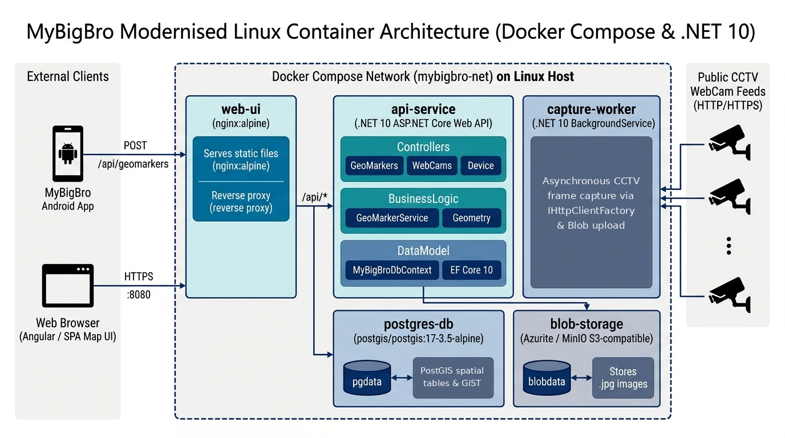

# MyBigBro (Modernised .NET 10, PostgreSQL/PostGIS & Linux Docker Compose)

My Big Bro captures and stores images from publicly available CCTV traffic cameras as GPS-enabled devices move within range of a camera's radius of visibility.

This repository contains the modernised cross-platform **Linux Docker Compose** microservices implementation targeting **.NET 10**, **ASP.NET Core 10**, **Entity Framework Core 10**, and **PostgreSQL 17 + PostGIS 3.5**.

For the complete architecture, migration details, and diagrams, see [**Modernisation/Modernisation-Plan.md**](Modernisation/Modernisation-Plan.md).

---

## Architecture Overview



### Microservices & Containers (`docker-compose.yml`)

| Container | Service | Technology | Host Port | Description |
| :--- | :--- | :--- | :--- | :--- |
| `mybigbro-web-ui` | `web-ui` | `nginx:1.27-alpine` + AngularJS + OpenStreetMap (Leaflet) | `http://localhost:8080` | Serves the OpenStreetMap web UI and reverse-proxies `/api/*` and `/healthz` to `api-service:8080` |
| `mybigbro-api` | `api-service` | `.NET 10` ASP.NET Core Web API | `http://localhost:5080` | Exposes REST endpoints (`/api/geomarkers`, `/api/webcams`, `/api/geomarkers/capturedimages`, `/healthz`) |
| `mybigbro-capture-worker` | `capture-worker` | `.NET 10` Worker Service | *(Internal)* | Polls `public.capture_job` (`FOR UPDATE SKIP LOCKED`), fetches live CCTV frames, and uploads blobs |
| `mybigbro-postgres` | `postgres-db` | `postgis/postgis:17-3.5-alpine` | `localhost:5433` | PostgreSQL 17 + PostGIS 3.5 database (`mybigbro`) with 105 seeded NZTA traffic cameras |
| `mybigbro-azurite` | `azurite-blob` | `mcr.microsoft.com/azure-storage/azurite` | `http://localhost:10000` | Local Azure Blob Storage v12 emulator (`devstoreaccount1/images`) |
| `mybigbro-s3` | `s3-storage` | `adobe/s3mock:latest` | `http://localhost:9090` | Local S3-compatible object storage emulator |

---

## Repository Structure

```text
MyBigBro-Azure/
├── Directory.Build.props                       # Shared .NET 10 SDK build properties
├── Directory.Packages.props                    # Central Package Management (CPM)
├── global.json                                 # .NET 10 SDK configuration
├── Infostructure.MyBigBro.Web.sln              # Clean 8-project .NET 10 solution
├── docker-compose.yml                          # Multi-container orchestration
├── docker/
│   ├── api/Dockerfile                          # Multi-stage .NET 10 Web API container build
│   ├── worker/Dockerfile                       # Multi-stage .NET 10 CaptureWorker build
│   ├── web-ui/Dockerfile                       # Nginx 1.27 Alpine Web UI & reverse proxy
│   ├── web-ui/nginx.conf                       # Nginx SPA + /api/* proxy configuration
│   └── postgres/
│       ├── 01-init-schema.sql                  # PostgreSQL 17 + PostGIS 3.5 schema DDL
│       └── 02-seed-webcams.sql                 # 105 NZTA traffic camera spatial seed records
├── Infostructure.MyBigBro.Domain/              # Domain interfaces, DTOs, and factories
├── Infostructure.MyBigBro.DataModel/           # EF Core 10 + Npgsql + PostGIS DbContext & entities
├── Infostructure.MyBigBro.ImageStorageServiceAgent/ # Azure Blob Storage v12 & AWS S3 v3 agents
├── Infostructure.MyBigBro.BusinessLogic/       # Spatial matching, GeoMarker & WebCam services
├── Infostructure.MyBigBro.Web4/                # ASP.NET Core 10 Web API & AngularJS map SPA
├── Infostructure.MyBigBro.CaptureWorker/       # Async background CCTV capture microservice
├── UnitTests/                                  # NUnit 3 + Moq unit test suite (16 tests)
├── IntegrationTests/                           # PostgreSQL + Blob Storage integration tests (6 tests)
└── Modernisation/                              # Architecture documentation and diagrams
```

---

## Quick Start

### 1. Run with Docker Compose
```bash
docker compose up --build -d
```

- **Web Map UI**: [http://localhost:8080](http://localhost:8080)
- **API Health Check**: [http://localhost:8080/healthz](http://localhost:8080/healthz) (or `http://localhost:5080/healthz`)
- **WebCams REST API**: [http://localhost:8080/api/webcams](http://localhost:8080/api/webcams)
- **Captured Images GeoMarkers API**: [http://localhost:8080/api/geomarkers/capturedimages?top=10](http://localhost:8080/api/geomarkers/capturedimages?top=10)

### 2. Record a GPS GeoMarker & Trigger CCTV Capture
```bash
curl -X POST http://localhost:8080/api/geomarkers \
  -H "Content-Type: application/json" \
  -d '{"MarkerDateTime":"2026-10-20T05:30:00Z","XCoord":174.746,"YCoord":-36.869,"DeviceName":"linux-docker-device"}'
```

### 3. Database Connection Details (PostgreSQL 17 + PostGIS)
- **Host**: `localhost`
- **Port**: `5433` *(mapped to `5432` inside `mybigbro-net`)*
- **Database**: `mybigbro`
- **Username**: `mybigbro`
- **Password**: `mybigbro_dev_pwd`

```bash
docker exec -it mybigbro-postgres psql -U mybigbro -d mybigbro -c "\dt public.*"
```

### 4. Build & Run Automated Tests (.NET 10)
```bash
dotnet build Infostructure.MyBigBro.Web.sln
dotnet test Infostructure.MyBigBro.Web.sln
```
